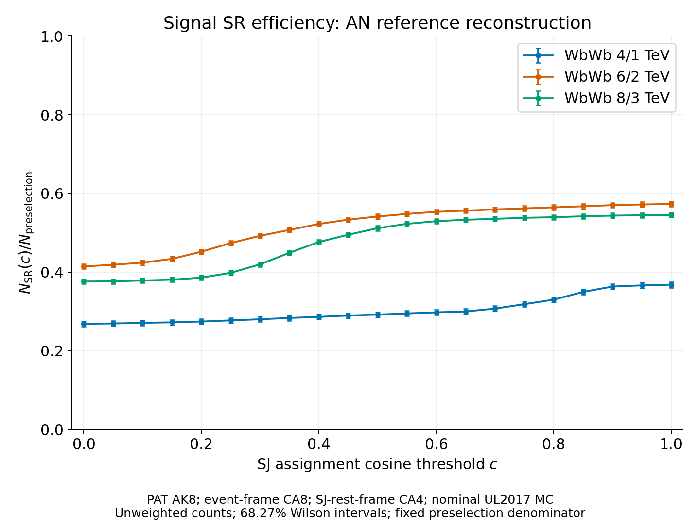

# AN reference cosine scan: completed 2026-11-18

Three nominal UL2017 WbWb benchmarks, 10,000 processed events each, evaluated at
21 cosine cutoffs from 0 to 1 in steps of 0.05. All output coverage and schema
checks passed. The fixed 0.85 reference anchor passed exact comparisons.

The denominator is the fixed number of events passing the AN baseline, including
failed reconstructions. Efficiencies below are unweighted conditional SR
fractions; interval bounds and weighted alternatives are in the numerical tables.

| WbWb masses [TeV] | Processed | Baseline | SR efficiency at c=0 | c=0.85 | c=1 |
| --- | ---: | ---: | ---: | ---: | ---: |
| 4 / 1 | 10,000 | 4,422 | 26.82% | 34.96% | 36.79% |
| 6 / 2 | 10,000 | 5,996 | 41.43% | 56.74% | 57.34% |
| 8 / 3 | 10,000 | 5,976 | 37.60% | 54.20% | 54.55% |

These are representative signal subsets. The curves alone do not determine
the best analysis cutoff because background sensitivity and mass shapes also
matter. See the [workflow and definitions](../../docs/an_cosine_scan.md).

## Files

- [Efficiency PDF](sr_efficiency_vs_cosine.pdf), [CSV](efficiency.csv) and
  [JSON](efficiency.json), with 63 sample/cutoff rows.
- [Reconstruction losses](reconstruction_losses_vs_cosine.pdf), also available
  as PNG. Invalid reconstructions and complexity guards remain in the denominator.
- Mass PDFs at every cutoff: [4/1 TeV](WbWb_4000_1000_mass_shapes_all_cosines.pdf),
  [6/2 TeV](WbWb_6000_2000_mass_shapes_all_cosines.pdf) and
  [8/3 TeV](WbWb_8000_3000_mass_shapes_all_cosines.pdf).
- `*_sj_mass_shapes.*` and `*_suu_mass_shapes.*` show representative overlays
  at c=0, 0.5, 0.85 and 1. Distributions are reconstructed, SR-selected and
  normalized within the displayed range; dashed lines show nominal masses.
- [Mass histogram counts and edges](mass_histograms.json),
  [input and validation provenance](provenance.json), and
  [artifact checksums](COMPLETE.json).

Repository integration passed all 254 tests with no skips. Regeneration reproduced
all 63 efficiency rows and mass histograms exactly; the CSV matched byte for byte.
The [validation record](validation.json) also records the three-job dry run and
comparison of the C++ source with the isolated compiled production source.

The first 10,000 events of the 18,000-event 4/1 TeV input were retained. The
6/2 TeV inputs cover 1,000 + 9,000 events and the 8/3 inputs cover
1,000 + 8,000 + 1,000. `provenance.json` records logical filenames, event-identity
and ROOT-output hashes, the compiled-bundle hash, and original source hashes.
The fixed-reference regression compared 200 scalar values on 20 matched events
against the prior frozen implementation with exact agreement.

Portable report JSON omits host-specific runtime paths. The original plot/table
bytes are retained where possible; `efficiency.json` uses the same numerical rows
with portable provenance. Raw ntuples and runtime directories remain local.
